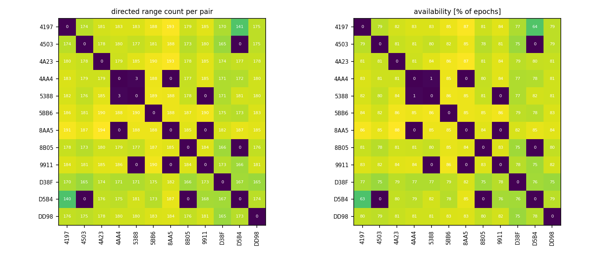
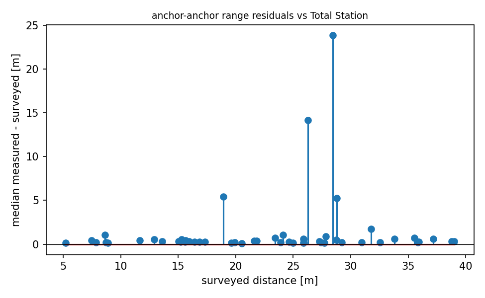

# QA report - s02 (quasi_static_point)

- epochs: 221, directed ranges: 21474 (13 invalid dropped at conversion)
- no timestamps in this campaign's logs; epoch ordering via seq
- ground-truth quality: **verified** (screen: multilateration deviation 0.219 m, range test: median line-of-sight residual +0.205 m, reference +0.158 to +0.251 m)

## Per-pair availability
- directed pairs observed: 122 of 132 possible
- weakest 5 directed pairs (availability % of epochs): 4503->D5B4 0%, 5388->9911 0%, 4AA4->8AA5 0%, 9911->8AA5 0%, 9911->5388 0%

## Mobile node (8B05)
- mobile<->anchor range std: median 0.03 m, max 0.87 m
- quasi-static truth: 8B05 at (4.69, 4.13, 1.29) (surveyed marker, z at the tag antenna)

## Geometry sanity (median measured vs surveyed anchor-anchor distance)
- 51 anchor pairs; residual mean +1.312 m, std 3.873 m, max |.| 23.860 m
- worst 5 pairs: 9911-D5B4 +23.86 m, 5BB6-8AA5 +14.14 m, 4503-5388 +5.45 m, 4197-D5B4 +5.24 m, 4AA4-D5B4 +1.72 m

## Figures

