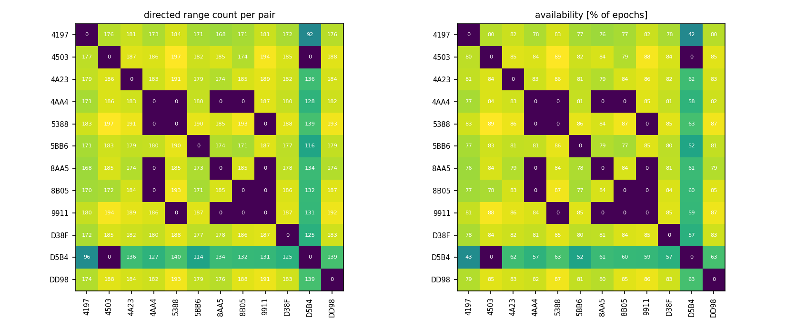
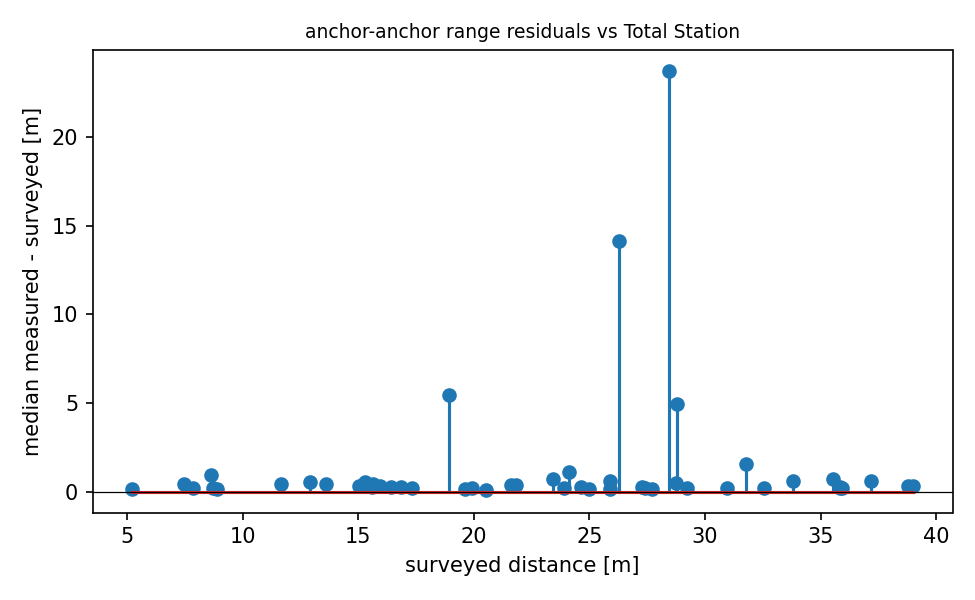

# QA report - s10 (quasi_static_point)

- epochs: 221, directed ranges: 20407 (14 invalid dropped at conversion)
- no timestamps in this campaign's logs; epoch ordering via seq
- ground-truth quality: **verified** (screen: multilateration deviation 0.35 m, range test: median line-of-sight residual +0.231 m, reference +0.158 to +0.251 m)

## Per-pair availability
- directed pairs observed: 118 of 132 possible
- weakest 5 directed pairs (availability % of epochs): 4503->D5B4 0%, 4AA4->5388 0%, 4AA4->8AA5 0%, 4AA4->8B05 0%, 5388->9911 0%

## Mobile node (8B05)
- mobile<->anchor range std: median 0.06 m, max 7.82 m
- quasi-static truth: 8B05 at (-6.33, 21.80, 1.29) (surveyed marker, z at the tag antenna)

## Geometry sanity (median measured vs surveyed anchor-anchor distance)
- 50 anchor pairs; residual mean +1.307 m, std 3.890 m, max |.| 23.731 m
- worst 5 pairs: 9911-D5B4 +23.73 m, 5BB6-8AA5 +14.14 m, 4503-5388 +5.42 m, 4197-D5B4 +4.95 m, 4AA4-D5B4 +1.53 m

## Figures

