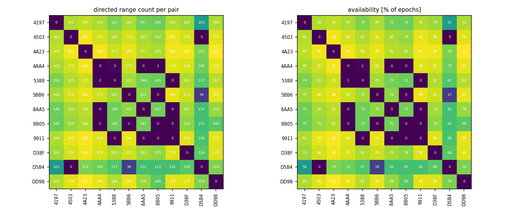
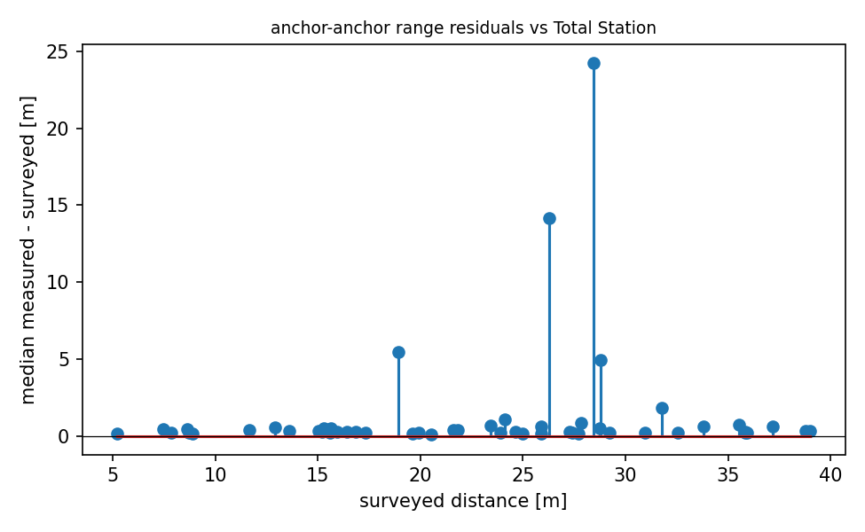

# QA report - s12 (quasi_static_point)

- epochs: 203, directed ranges: 18596 (13 invalid dropped at conversion)
- no timestamps in this campaign's logs; epoch ordering via seq
- ground-truth quality: **verified** (screen: multilateration deviation 9.93 m, range test: median line-of-sight residual +0.208 m, reference +0.158 to +0.251 m)

## Per-pair availability
- directed pairs observed: 121 of 132 possible
- weakest 5 directed pairs (availability % of epochs): 4503->D5B4 0%, 5388->9911 0%, 4AA4->8AA5 0%, 9911->8AA5 0%, 8AA5->9911 0%

## Mobile node (8B05)
- mobile<->anchor range std: median 3.27 m, max 7.28 m
- quasi-static truth: 8B05 at (-13.35, 21.26, 1.30) (surveyed marker, z at the tag antenna)

## Geometry sanity (median measured vs surveyed anchor-anchor distance)
- 51 anchor pairs; residual mean +1.302 m, std 3.915 m, max |.| 24.239 m
- worst 5 pairs: 9911-D5B4 +24.24 m, 5BB6-8AA5 +14.15 m, 4503-5388 +5.46 m, 4197-D5B4 +4.96 m, 4AA4-D5B4 +1.81 m

## Figures

