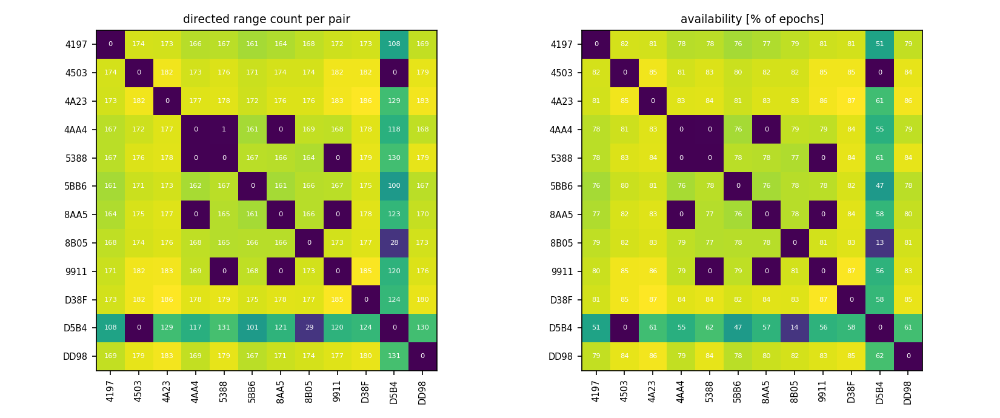
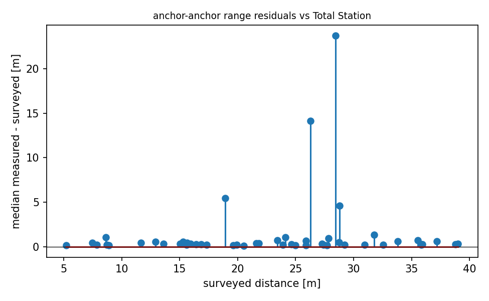

# QA report - s20 (quasi_static_point)

- epochs: 213, directed ranges: 19878 (20 invalid dropped at conversion)
- no timestamps in this campaign's logs; epoch ordering via seq
- ground-truth quality: **verified** (screen: multilateration deviation 0.36 m, range test: median line-of-sight residual +0.200 m, reference +0.158 to +0.251 m)

## Per-pair availability
- directed pairs observed: 123 of 132 possible
- weakest 5 directed pairs (availability % of epochs): 4503->D5B4 0%, 5388->4AA4 0%, 4AA4->8AA5 0%, 5388->9911 0%, 9911->5388 0%

## Mobile node (8B05)
- mobile<->anchor range std: median 0.05 m, max 3.10 m
- quasi-static truth: 8B05 at (4.94, 10.07, 1.27) (surveyed marker, z at the tag antenna)

## Geometry sanity (median measured vs surveyed anchor-anchor distance)
- 51 anchor pairs; residual mean +1.287 m, std 3.847 m, max |.| 23.741 m
- worst 5 pairs: 9911-D5B4 +23.74 m, 5BB6-8AA5 +14.15 m, 4503-5388 +5.43 m, 4197-D5B4 +4.59 m, 4AA4-D5B4 +1.32 m

## Figures

