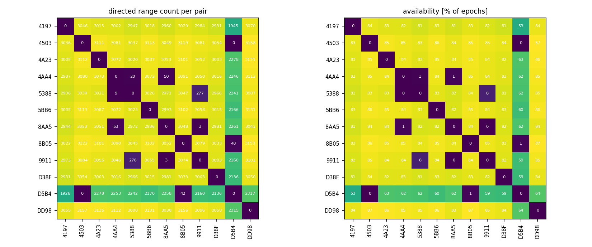
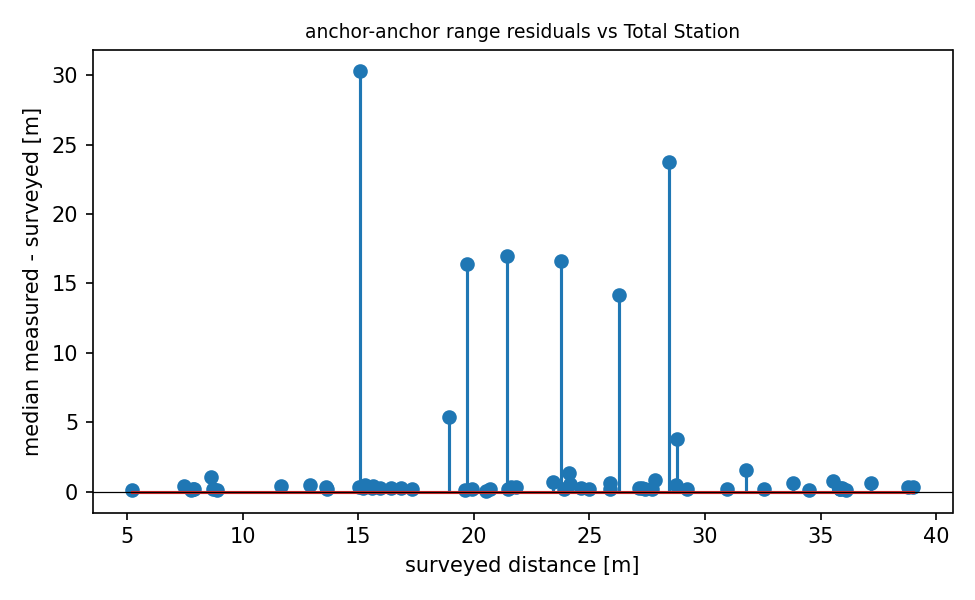

# QA report - s21 (static)

- epochs: 3640, directed ranges: 351263 (326 invalid dropped at conversion)
- no timestamps in this campaign's logs; epoch ordering via seq

## Per-pair availability
- directed pairs observed: 130 of 132 possible
- weakest 5 directed pairs (availability % of epochs): 4503->D5B4 0%, D5B4->4503 0%, 8AA5->9911 0%, 9911->8AA5 0%, 5388->4AA4 0%

## Geometry sanity (median measured vs surveyed anchor-anchor distance)
- 65 anchor pairs; residual mean +2.263 m, std 5.910 m, max |.| 30.300 m
- worst 5 pairs: 8AA5-9911 +30.30 m, 9911-D5B4 +23.76 m, 8B05-D5B4 +16.94 m, 5388-9911 +16.60 m, 4AA4-8AA5 +16.39 m

## Figures

