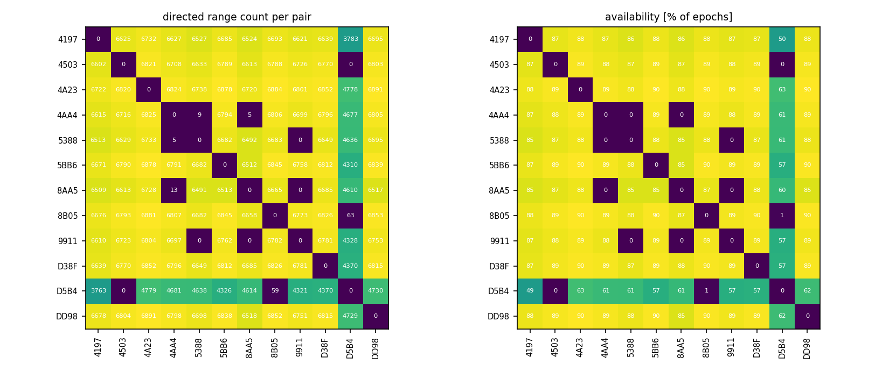
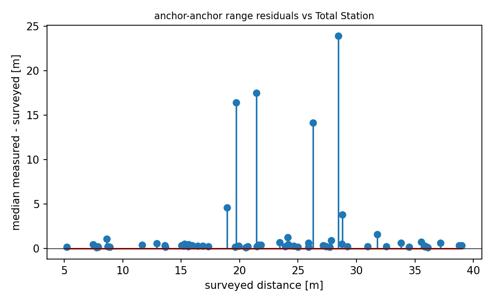

# QA report - s22 (static)

- epochs: 7626, directed ranges: 766753 (747 invalid dropped at conversion)
- no timestamps in this campaign's logs; epoch ordering via seq

## Per-pair availability
- directed pairs observed: 126 of 132 possible
- weakest 5 directed pairs (availability % of epochs): 4503->D5B4 0%, 5388->9911 0%, D5B4->4503 0%, 9911->8AA5 0%, 9911->5388 0%

## Geometry sanity (median measured vs surveyed anchor-anchor distance)
- 63 anchor pairs; residual mean +1.592 m, std 4.463 m, max |.| 23.914 m
- worst 5 pairs: 9911-D5B4 +23.91 m, 8B05-D5B4 +17.51 m, 4AA4-8AA5 +16.41 m, 5BB6-8AA5 +14.14 m, 4503-5388 +4.56 m

## Figures

