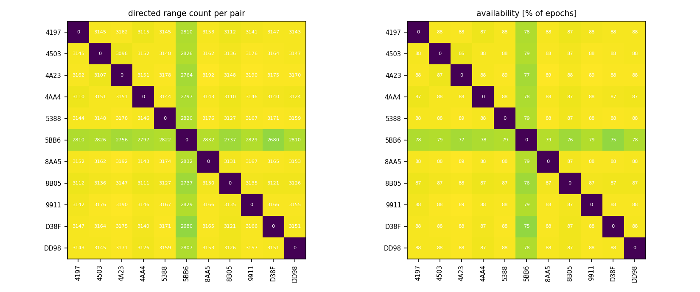
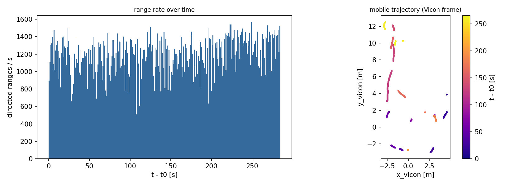
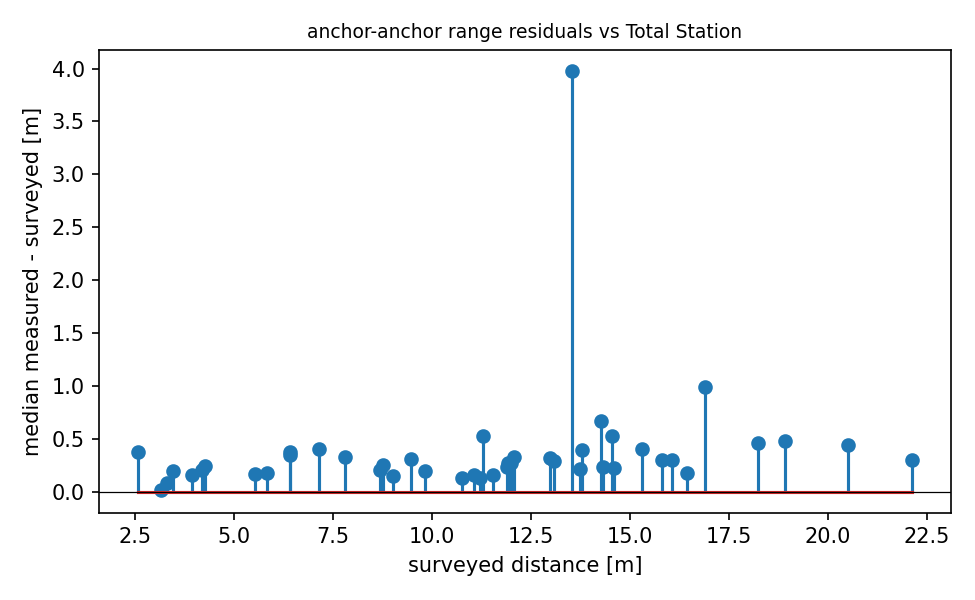

# QA report - s01 (dynamic)

- epochs: 3589, directed ranges: 339258 (229 invalid dropped at conversion)
- span: 284.6 s, mean epoch rate: 12.61 Hz
- clock: offset 6.889 s +/- 0.1 s (method min_envelope, n=668; logger queue lag reached 54.5 s -> broker times unusable directly)

## Per-pair availability
- directed pairs observed: 110 of 110 possible
- weakest 5 directed pairs (availability % of epochs): D38F->5BB6 75%, 5BB6->D38F 75%, 8B05->5BB6 76%, 5BB6->8B05 76%, 5BB6->4A23 77%

## Mobile node (DD98)
- mobile<->anchor range std: median 3.53 m, max 5.06 m
- Vicon: 6296 poses, burst rate 120 Hz, mean rate 23.7 Hz, path length 77.7 m, bbox 7.5 x 15.5 x 0.49 m
- Vicon coverage: 26 gaps > 1 s (total 212.7 s of 265.6 s), max gap 36.06 s
- Vicon labeling: 12 implausible-speed anomalies (>5 m/s between close poses), frames strictly increasing: True

## Geometry sanity (median measured vs surveyed anchor-anchor distance)
- 45 anchor pairs; residual mean +0.379 m, std 0.574 m, max |.| 3.977 m
- worst 5 pairs: 5BB6-D38F +3.98 m, 4AA4-9911 +0.99 m, 4A23-4AA4 +0.67 m, 4197-4A23 +0.53 m, 8AA5-9911 +0.53 m

## Figures

