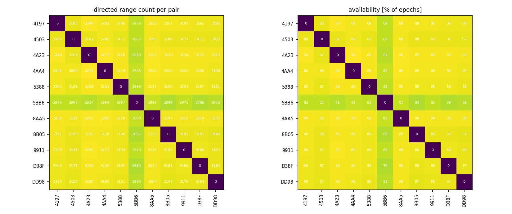
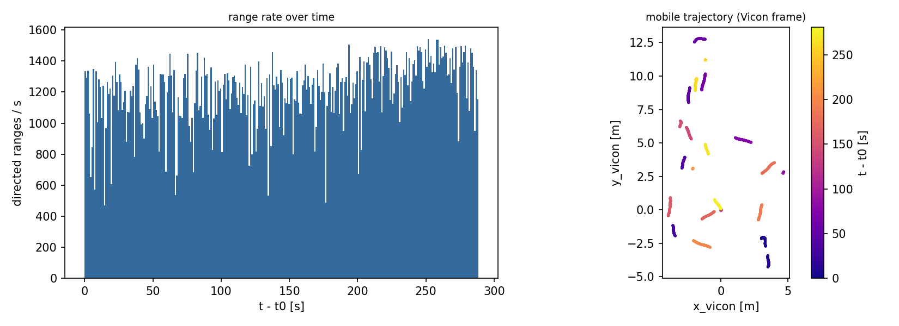
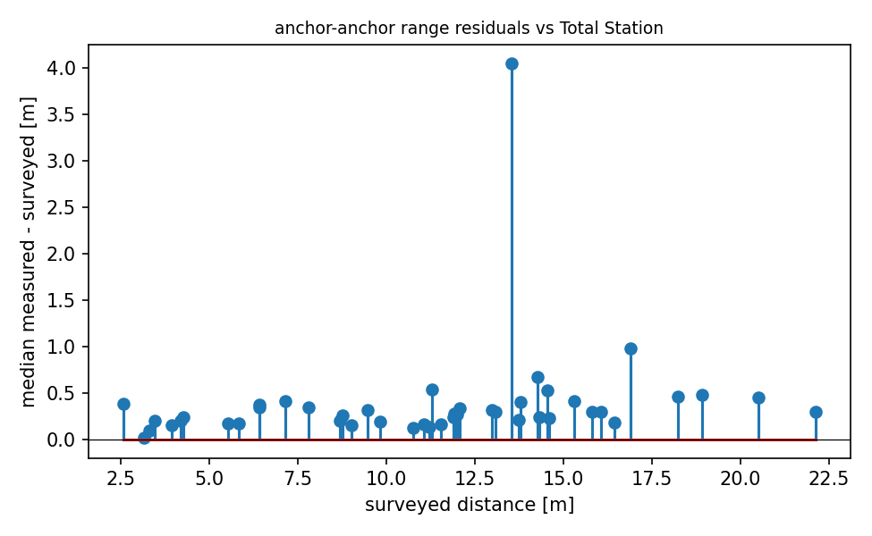

# QA report - s02 (dynamic)

- epochs: 3626, directed ranges: 347142 (169 invalid dropped at conversion)
- span: 288.3 s, mean epoch rate: 12.58 Hz
- clock: offset 6.847 s +/- 0.1 s (method min_envelope, n=755; logger queue lag reached 49.5 s -> broker times unusable directly)

## Per-pair availability
- directed pairs observed: 110 of 110 possible
- weakest 5 directed pairs (availability % of epochs): D38F->5BB6 79%, 5BB6->D38F 79%, 5BB6->8B05 80%, 8B05->5BB6 80%, 5BB6->4A23 81%

## Mobile node (DD98)
- mobile<->anchor range std: median 3.72 m, max 5.43 m
- Vicon: 6767 poses, burst rate 120 Hz, mean rate 24.1 Hz, path length 105.2 m, bbox 8.6 x 17.1 x 0.74 m
- Vicon coverage: 24 gaps > 1 s (total 224.5 s of 280.7 s), max gap 36.78 s
- Vicon labeling: 13 implausible-speed anomalies (>5 m/s between close poses), frames strictly increasing: True

## Geometry sanity (median measured vs surveyed anchor-anchor distance)
- 45 anchor pairs; residual mean +0.381 m, std 0.583 m, max |.| 4.048 m
- worst 5 pairs: 5BB6-D38F +4.05 m, 4AA4-9911 +0.98 m, 4A23-4AA4 +0.67 m, 4197-4A23 +0.54 m, 8AA5-9911 +0.53 m

## Figures

