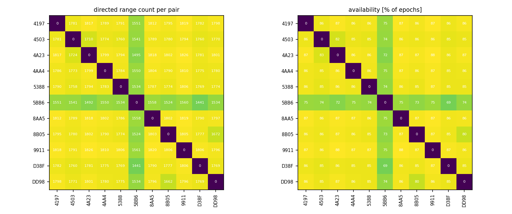
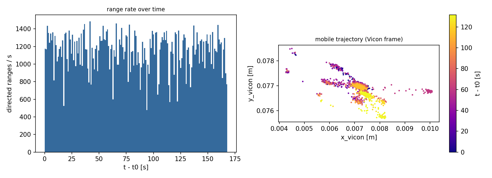
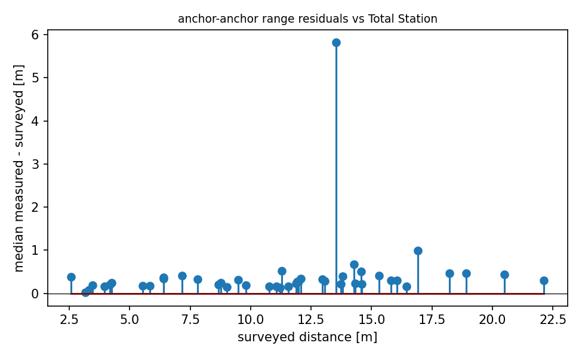

# QA report - s03 (static)

- epochs: 2080, directed ranges: 191423 (185 invalid dropped at conversion)
- span: 167.9 s, mean epoch rate: 12.39 Hz
- clock: offset 6.864 s +/- 0.1 s (method min_envelope, n=327; logger queue lag reached 49.1 s -> broker times unusable directly)

## Per-pair availability
- directed pairs observed: 110 of 110 possible
- weakest 5 directed pairs (availability % of epochs): D38F->5BB6 69%, 5BB6->D38F 69%, 5BB6->4A23 72%, 4A23->5BB6 72%, 5BB6->8B05 73%

## Mobile node (DD98)
- mobile<->anchor range std: median 0.02 m, max 0.07 m
- Vicon: 3087 poses, burst rate 120 Hz, mean rate 23.5 Hz, path length 0.6 m, bbox 0.0 x 0.0 x 0.00 m
- Vicon coverage: 17 gaps > 1 s (total 105.6 s of 131.5 s), max gap 9.14 s
- Vicon labeling: 0 implausible-speed anomalies (>5 m/s between close poses), frames strictly increasing: True

## Geometry sanity (median measured vs surveyed anchor-anchor distance)
- 45 anchor pairs; residual mean +0.419 m, std 0.840 m, max |.| 5.821 m
- worst 5 pairs: 5BB6-D38F +5.82 m, 4AA4-9911 +0.99 m, 4A23-4AA4 +0.67 m, 4197-4A23 +0.53 m, 8AA5-9911 +0.51 m

## Figures

